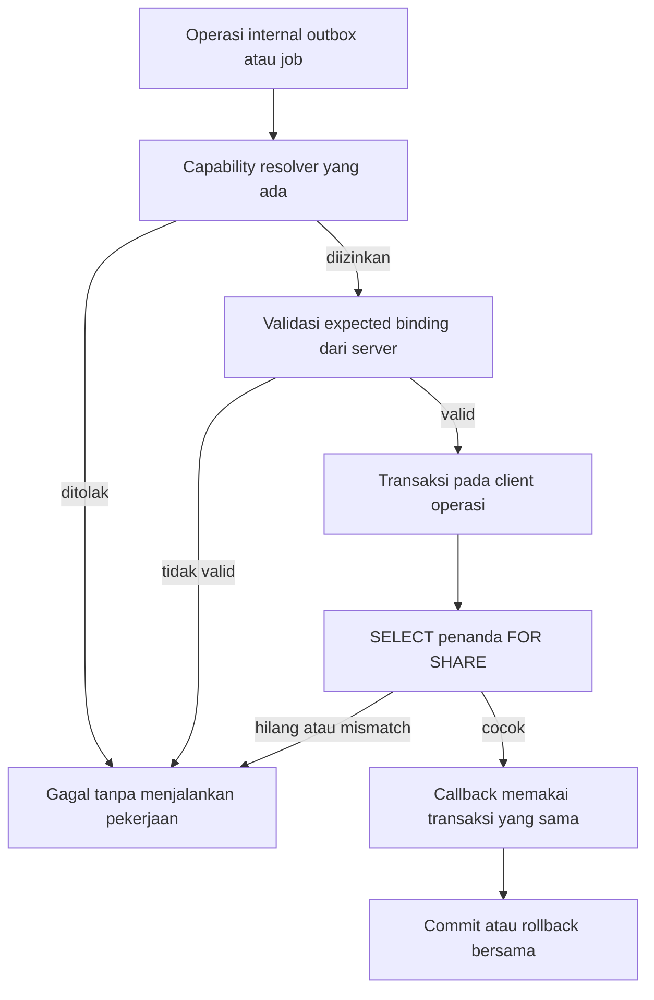

# Batch 2, Slice 2.1 — Verifikasi binding database

**Status:** Implementasi lokal terverifikasi dan review kode independen selesai dengan **0 findings**, 13 Oktober 2026. Rancangan dan implementasi diizinkan dalam percakapan pada tanggal yang sama. Hasil aktual ada pada rencana implementasi; consumer aplikasi/hosted belum dihubungkan. Persetujuan slice ini tidak mengaktifkan layanan atau memberikan izin deployment.

**Tujuan:** Menetapkan satu batas operasi database yang dapat diuji: pekerjaan calon outbox/job hanya boleh menulis jika database yang terhubung memiliki penanda binding dan tier yang sesuai dengan konfigurasi server. Pemeriksaan dan pekerjaan database berlangsung dalam transaksi yang sama.

## Dasar dan batas authority

[Tech Design aktif](../../TechDesign-Niuva-MVP.md#rekonsiliasi-kontrak-teknis-rilis--13-oktober-2026), [kontrak hosted/outbox/job](../../legal/customer-public-runtime-contract.md#hosted-origin-dan-capability), dan [ledger rilis](../../frontend/mvp-release-readiness.md#peta-penghambat-rilis) adalah sumber kebutuhan. Dokumen ini menetapkan rincian teknis slice; bukan keputusan produk baru, pengesahan policy, atau bukti hosted. [Rencana implementasi](../plans/2026-10-13-batch-2-database-binding.md) menyimpan tugas dan hasil pelaksanaannya.

Baseline source adalah `a577b7c326ff42d3a642cf5f0b93ccdf59c26bef`, ditambah rekonsiliasi dokumentasi Batch 1 yang belum di-commit. Tidak ada perubahan runtime pada tahap perancangan ini.

## Temuan kode yang menentukan slice

| Source saat ini | Implikasi |
| --- | --- |
| [Deployment resolver](../../../src/lib/env/deployment.ts) memisahkan `local-test`/`staging`/`production` dari `mock`/`sandbox`/`live`; activation grants masih kosong. | Gunakan resolver yang ada. Jangan membuat flag aktivasi atau menafsirkan build production sebagai izin live. |
| [Origin resolver](../../../src/lib/env/origin.ts) sudah mengatur canonical origin sesuai tier. | Origin/cookie/CSP tidak ditulis ulang oleh slice database. |
| [Capability matrix](../../../src/modules/capabilities/matrix.ts) mensyaratkan database untuk `emailDelivery` dan `scheduledJobs`. [Resolver](../../../src/modules/capabilities/resolver.ts) memeriksa resource/config/policy/grant. | Tetap pakai kedua capability tersebut sebagai gate pertama. `outbox` dan `job` hanya label operasi internal. |
| [Server capabilities](../../../src/lib/env/server.ts) menilai database dari keberadaan `DATABASE_URL`. | Konfigurasi terisi belum mengidentifikasi database yang benar-benar dipakai operasi. |
| [Prisma factory](../../../src/lib/db/prisma.ts) menyediakan client bersama. [Schema](../../../prisma/schema.prisma) belum memiliki penanda deployment database. | Tambahkan penanda dan repository yang memakai client/transaksi operasi; jangan membuka koneksi pemeriksaan terpisah. |
| Schema belum mempunyai durable email outbox; script cleanup lokal dan [endpoint retensi analytics](../../../src/app/api/analytics/retention/route.ts) memiliki kontrak masing-masing. | Slice ini tidak mengaku mengganti scheduler atau menyelesaikan pengiriman email. Consumer lama tetap mengikuti kontraknya. |

## Pilihan yang dinilai

| Pilihan | Penilaian |
| --- | --- |
| Menyelesaikan hosted, outbox dan seluruh job sekaligus | Terlalu banyak hasil yang harus dibuktikan bersamaan: resource, payload sensitif, delivery, lease/retry, scheduler dan operasi. Sulit menentukan penyebab kegagalan. |
| Memeriksa keberadaan URL atau nama host saja | Tidak cukup membedakan database/tier yang salah pada host yang sama. Pemeriksaan ini sudah sebagian ada. |
| Penanda database dan pemeriksaan dalam transaksi operasi | **Direkomendasikan.** Memakai PostgreSQL/Prisma yang sudah ada, mempunyai kasus gagal yang jelas, dan menyediakan batas untuk slice outbox/job berikutnya. |

Hasil Slice 2.1 adalah fondasi internal dengan integration probe, belum fitur yang terlihat Customer. REL-02 tetap terbuka; REL-03 dan REL-04 belum memperoleh implementasi outbox/job dari pekerjaan ini.

## Kontrak penanda dan konfigurasi

Model `DeploymentDatabaseBinding` dipetakan ke tabel `deployment_database_bindings`:

| Field | Kontrak |
| --- | --- |
| `id` | Integer primary key; SQL `CHECK (id = 1)` membatasi tabel menjadi paling banyak satu penanda. |
| `bindingId` / `binding_id` | UUID, `NOT NULL`, unik. Identitas yang dipilih saat provisioning resource, bukan dari request Customer atau row job. |
| `tier` / `deployment_tier` | String `NOT NULL`; SQL `CHECK` membatasi `local-test`, `staging`, `production`. |
| `createdAt` / `created_at` | Timestamp database saat penanda dibuat; metadata, bukan bukti izin aktivasi. |

Migration baru hanya membuat tabel/constraint. Tidak menyisipkan penanda, menyalin penanda lintas lingkungan, atau memperbaiki mismatch secara otomatis. Tabel kosong harus menolak pekerjaan yang memakai guard ini.

Nama konfigurasi guard adalah `NIUVA_DATABASE_BINDING_ID`, server-only. Reader baru memvalidasi UUID dan menormalisasi representasinya sebelum dibandingkan. Variabel ini wajib **ketika guard baru dipanggil**, bukan syarat baru untuk static build atau seluruh flow lama. Tidak mengubah `DATABASE_URL`, menambahkan nilai ke `.env*`, atau memakai awalan `NEXT_PUBLIC_`. Parsing config binding dilakukan dalam modul baru agar nilai kosong/salah tidak mengubah perilaku global parser environment lama.

Tier berasal dari resolver yang ada. `NODE_ENV=production` dengan tier eksplisit `staging` tetap dapat mewakili runtime staging; `NODE_ENV=staging` tidak digunakan. Mode/grant/policy yang ditolak tetap ditolak walaupun penanda cocok.

Provisioning, rebind, pembatasan role database dan bukti pemisahan resource menjadi pekerjaan lingkungan tersendiri. Jalur aplikasi hanya membaca penanda; tidak disediakan API, UI Admin, seed startup, atau method repository untuk membuat/menggantinya. Fixture test memiliki jalur setup sendiri pada database test terisolasi.

Kontrak privilege minimum pada tabel marker adalah `SELECT` serta **`UPDATE(id)` saja**, selain izin koneksi/schema yang diperlukan. PostgreSQL mensyaratkan privilege UPDATE pada sedikitnya satu kolom untuk `FOR SHARE`. `CHECK (id = 1)` tetap wajib sehingga kolom tersebut tidak dapat diganti nilainya; kode runtime tidak menjalankan UPDATE. Role runtime tidak menjadi pemilik tabel/superuser, tidak mewarisi privilege lebih luas, dan tidak mendapat `INSERT`, `DELETE`, `TRUNCATE`, atau UPDATE atas `binding_id`, `deployment_tier`, maupun `created_at`. Jangan memberi UPDATE seluruh tabel untuk mengatasi error lock. Provisioning nyata tetap di luar slice; pembuktian privilege memakai role test terbatas yang bukan pemilik tabel.

## Alur dan antarmuka implementasi



Pembagian modul mengikuti kontrak repository/service proyek:

- `core.ts`: tipe expectation, validasi config/row dan pembandingan tier/UUID; fungsi deterministik tanpa koneksi database.
- `repository.ts`: SQL/Prisma, transaksi dan row lock; menerima client operasi melalui dependency injection.
- `service.ts`: komposisi capability dan binding; tidak memiliki SQL atau aturan pengiriman email.

Antarmuka minimum, tanpa objek izin yang dapat disimpan/dikirim ulang:

```ts
type DatabaseBindingExpectation = Readonly<{
  tier: DeploymentTier;
  bindingId: string;
}>;

interface DatabaseBindingRepository {
  withVerifiedBinding<T>(
    expected: DatabaseBindingExpectation,
    work: (tx: Prisma.TransactionClient) => Promise<T>,
  ): Promise<T>;
}

interface BoundDatabaseService {
  run<T>(
    operation: "outbox" | "job",
    work: (tx: Prisma.TransactionClient) => Promise<T>,
  ): Promise<T>;
}
```

`outbox` memeriksa `emailDelivery`; `job` memeriksa `scheduledJobs`. Nama capability, allowed modes, activation grants, policy reader, serta guard provider lama tidak diubah. Grant fixture hanya diberikan melalui dependency injection pada test; production tidak mendapat grant baru.

Service mengambil salinan konfigurasi server yang konsisten untuk satu eksekusi, termasuk input resolver dan expected binding. Konfigurasi proses dianggap tetap sepanjang boot. Bila test menyuntikkan environment/client, keduanya harus dinyatakan eksplisit; jangan menyelesaikan capability dari environment fixture lalu memeriksa client ambient tanpa sengaja. Repository dibuat/dipanggil hanya setelah gate capability dan config lulus.

Repository membuka interactive transaction pada client yang akan menjalankan operasi, membaca row `id = 1` dengan `SELECT ... FOR SHARE`, memvalidasi hasil sebagai data tak tepercaya, dan membandingkan tier serta UUID. Callback menerima **transaction client yang sama**. Future service menggunakannya untuk memanggil repository domain, bukan menaruh SQL pada route/service. Callback gagal berarti perubahan database callback ikut rollback. Missing row, mismatch, malformed row, timeout/koneksi/query gagal berarti callback tidak dipanggil.

Lock bertahan sampai transaksi selesai, menghalangi UPDATE/DELETE penanda oleh transaksi lain dan tetap mengizinkan pembaca bersama. Jangan melakukan request provider, send email, atau pekerjaan lama di dalam callback. Pemanggilan jaringan oleh worker kelak memerlukan protokol claim/send/reconcile tersendiri; transaksi binding tidak menjamin atomicity antara database dan provider.

Kegagalan service dipetakan ke `AppError`/`PROVIDER_UNAVAILABLE` yang sudah ada, status 503, dengan pesan aman. Kategori internal boleh membedakan capability/config/missing/mismatch/database failure; pesan publik dan log tidak memuat URL database, UUID expected/actual, raw SQL/error adapter, token, atau payload Customer. Slice ini tidak menambahkan route publik atau sistem logging baru.

## Kriteria penerimaan implementasi

| ID | Perilaku yang harus dibuktikan | Bukti |
| --- | --- | --- |
| DBB-01 | Missing/malformed binding config menolak kerja; konfigurasi global/flow lama tetap kompatibel. | Unit config + regresi environment/capability. |
| DBB-02 | Capability deny tidak membuka repository/transaksi; marker cocok tidak melewati mode/grant/policy. | Backend service dengan spy repository, termasuk default grants kosong dan production/live yang ditolak. |
| DBB-03 | Marker hilang, malformed, UUID salah atau tier salah tidak memanggil callback. | Unit comparison, backend failure, integration database. |
| DBB-04 | Marker cocok menjalankan probe database pada transaction client yang sama; hasil commit terlihat. | Integration PostgreSQL, probe sintetis. |
| DBB-05 | Callback throw membatalkan probe; kegagalan repository menghasilkan error aman. | Integration rollback + backend error mapping. |
| DBB-06 | UPDATE/DELETE penanda menunggu selama callback memegang shared lock; dua pembaca bersama dapat berjalan. | Integration dua koneksi dengan barrier dan timeout lock fixture yang dibatasi. |
| DBB-07 | Constraint singleton/tier/UUID menolak row invalid; migration additive dan tanpa seed. | Review migration + integration constraint. |
| DBB-08 | Pemisahan tier/mode, origin, grants, policy, auth/payment/privacy lama dan seluruh gate aplikasi tetap utuh. | Gate lengkap proyek; tidak mengganti consumer lama dalam slice ini. |
| DBB-09 | Role runtime terbatas dapat mengambil `FOR SHARE`, tetapi tidak dapat INSERT/DELETE/TRUNCATE atau mengganti UUID/tier/timestamp; perubahan `id` menjadi selain 1 ditolak constraint. | Integration role fixture bukan owner dengan SELECT + UPDATE(id); izin role tidak disimpulkan dari test koneksi berprivilege tinggi. |

Probe memakai record sintetis `IdempotencyRecord` dengan scope/key acak yang dimiliki suite. Test mengikuti [safe test database setup](../../../tests/integration/setup.ts), wrapper database test, dan konfigurasi integration yang serial. Bila sudah ada marker yang bukan milik suite, hentikan fixture dan gunakan database test baru; jangan reset atau menghapus penanda/data yang tidak dimiliki test. Cleanup hanya fixture milik suite pada database test yang lolos guard. Jangan menyimpulkan pemisahan deployment fisik dari test UUID/tier.

Test locking memakai barrier antarkoneksi; assertion memakai `lock_timeout` transaksi fixture dan SQLSTATE `55P03` untuk konflik UPDATE/DELETE. Tidak memakai sleep arbitrer, mengubah timeout global, atau menganggap timeout Vitest sebagai bukti row lock. Test pembaca bersama membuktikan keduanya mencapai barrier sebelum transaksi dilepas.

Test privilege menyiapkan role fixture terbatas pada database/cluster test terisolasi, tanpa akses credential production. Kepemilikan/cleanup role dan grants dibatasi pada fixture suite. Jika role fixture tidak dapat disiapkan, catat DBB-09 belum terbukti dan perbaiki setup test terisolasi; jangan silent skip atau menambah privilege lingkungan nyata. Uji role ini tetap tidak membuktikan privilege deployment hosted yang belum diperiksa.

## Batas hasil dan urutan setelahnya

Binding adalah pengaman salah konfigurasi. Clone database yang membawa penanda yang sama, atau administrator berhak tinggi yang mengganti penanda/config, masih dapat melewati pembandingan. Isolasi akun/resource, pembatasan role, provisioning dan recovery tetap perlu bukti lingkungan. Pemeriksaan ini juga tidak mengamankan pekerjaan yang belum menggunakannya.

Slice berikut yang direkomendasikan:

1. **2.2 — durable outbox**: identitas pesan, state/lease/expiry, perlindungan isi sensitif, pembatalan proof/account, dan idempotensi enqueue. Memakai binding ini untuk operasi database, tanpa menganggap enqueue sebagai delivery.
2. **2.3 — worker dan kerangka job**: claim/send/reconcile, service identity, retry/checkpoint/dry-run, observability dan alarm. Scheduler/provider/topologi dipilih berdasarkan input resource yang telah diverifikasi.
3. **Bukti hosted**: wiring consumer, migrasi lingkungan yang diizinkan, resource terpisah, inbox/provider nyata serta operasi/recovery. Ini yang kelak dapat menutup bagian REL-02/03/04, bukan dokumen Slice 2.1.

Tidak memilih vendor antrean baru, dependency baru, kalender/SLA, retensi bisnis, key produksi, nama resource nyata, atau petugas engineering yang belum ditugaskan. Tidak mengubah signup, refund, lifecycle closure, R2, B2B WhatsApp atau public UI. Tidak menjalankan migration, provisioning, commit, push, deployment atau provider smoke pada tahap desain.

## Dasar teknis eksternal

- [PostgreSQL 18 — constraints](https://www.postgresql.org/docs/18/ddl-constraints.html): gunakan primary key/unique, `NOT NULL` dan `CHECK` untuk batas row/field; constraint tidak menjadi bukti isolasi lingkungan.
- [PostgreSQL 18 — explicit locking](https://www.postgresql.org/docs/18/explicit-locking.html): `FOR SHARE` menahan perubahan/penghapusan row sampai transaksi selesai dan mengizinkan shared readers. Versi 18 sesuai service PostgreSQL pada CI repository saat desain diperiksa.
- [PostgreSQL 18 — SELECT](https://www.postgresql.org/docs/18/sql-select.html): locking clause membutuhkan SELECT pada kolom yang dibaca serta UPDATE pada sedikitnya satu kolom tabel. Ini mendasari grant kolom terbatas di atas, bukan UPDATE seluruh marker.
- Panduan environment Next yang terpasang pada source checkout (`node_modules/next/dist/docs/01-app/02-guides/environment-variables.md`, Next 16.3.6) menegaskan env server, inlining `NEXT_PUBLIC_`, dan nilai `NODE_ENV` yang didukung. Panduan package lokal menjadi rujukan sebelum implementasi; tidak memperkenalkan `NODE_ENV=staging`.

## Verifikasi tahap desain

Snapshot perancangan dan review dokumen dicatat pada [rencana implementasi](../plans/2026-10-13-batch-2-database-binding.md#hasil-tahap-perancangan). Pada tahap tersebut DBB-01–09 belum diuji; hasil implementasi lokal sekarang dicatat terpisah pada [bukti implementasi](../plans/2026-10-13-batch-2-database-binding.md#hasil-implementasi-lokal--13-oktober-2026). Bukti itu tidak menggantikan provisioning atau verifikasi hosted.
